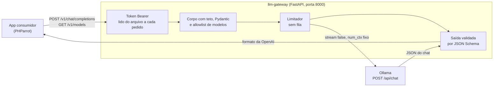

# Arquitetura

O gateway é um proxy fechado entre um app e um LLM local. O app fala o formato da API da OpenAI. O gateway fala só `POST /api/chat` com o Ollama.

## Responsabilidades

| Módulo (`src/llm_gateway/`) | Papel |
|---|---|
| `app.py` | A factory `criar_app`. Monta o `app.state` (`config`, `limitador`, `cliente_ollama`), o router `/v1` com o token e o `/health`. Fecha o cliente HTTP no `lifespan`. |
| `config.py` | Lê as variáveis `GATEWAY_*`. Configuração inválida impede a subida. |
| `autenticacao.py` | Lê o token do arquivo, extrai o Bearer e compara em tempo constante. |
| `chat.py` | A rota do chat: lê o corpo com teto, valida o pedido, monta o corpo do Ollama, confere a saída, formata a resposta e registra as métricas. |
| `subconjunto.py` | A lista de palavras-chave do JSON Schema do pedido e os tetos de nós, profundidade e tamanho. |
| `modelos.py` | A allowlist: recusa o modelo fora da lista e monta o `GET /v1/models`. |
| `concorrencia.py` | O `Limitador`: vagas sem espera. |
| `ollama.py` | O cliente HTTP do upstream, os tempos, o contexto fixo e a tradução de falha de rede em erro do gateway. |
| `erros.py` | `ErroOpenAI`, o enum `Codigo` e os tratadores. Todo erro sai no formato da OpenAI. |
| `contrato.py` | As respostas de erro que as rotas declaram no OpenAPI (status, cabeçalhos `Retry-After` e `WWW-Authenticate`). |
| `registro.py` | O log em JSON, uma linha por evento, no stdout. |

O estado compartilhado fica em `app.state`. Não há variável de módulo mutável. O `criar_app` aceita um `transporte` do `httpx2` para os testes trocarem o upstream.

## O caminho de um pedido

Para `POST /v1/chat/completions`, na ordem em que o código executa:

1. **Token.** A dependência `exigir_token` do router `/v1` lê o arquivo, extrai o Bearer e compara. Falha dá 401 ou 503. O corpo nem é lido.
2. **Corpo.** `ler_corpo` recusa mais de 64 KiB com 413, pelo `Content-Length` ou contando o que chega.
3. **Pedido.** `interpretar` valida com Pydantic (`extra="forbid"`, limites em todo campo), recusa `stream: true` e confere a soma dos caracteres das mensagens. Falha dá 400.
4. **Modelo.** `exigir_modelo_permitido` recusa o que não está na allowlist, com 404.
5. **Schema.** `preparar_validador` confere o subconjunto de palavras-chave e os tetos (`exigir_subconjunto`) e valida o `response_format` como JSON Schema (Draft 2020-12). Fora do subconjunto ou inválido dá 400 `schema_invalido`.
6. **Vaga.** `Limitador.vaga()` tenta pegar uma vaga. Sem vaga, 503 `ocupado` com `Retry-After`.
7. **Upstream.** `conversar` faz `POST /api/chat` no Ollama com `stream: false`, `format` (o schema) e `num_ctx` fixo. Falha de rede, tempo esgotado, status diferente de 200 e corpo fora do formato viram 503, 504 e 502, sem repassar o texto do upstream. A vaga é devolvida ao sair.
8. **Saída.** Com schema, `conferir_saida` recusa resposta cortada pelo `max_tokens` (502 `saida_truncada`) e resposta que não é JSON ou não segue o schema (502 `saida_invalida`).
9. **Resposta.** `formatar` monta a `chat.completion` da OpenAI.
10. **Métricas.** Sempre, com sucesso ou erro, uma linha JSON sem texto (`docs/operacao.md`).

## O que fica fora

- Stream: `stream: true` é recusado.
- Fila: o `Limitador` não espera.
- Operação administrativa no Ollama (baixar, apagar, listar o que existe) e qualquer rota do upstream além do `/api/chat`.
- Documentação interativa em runtime: `/docs`, `/redoc` e `/openapi.json` respondem 404. O OpenAPI está em `docs/openapi.json`.
- Banco de dados, motor pago e servidor MCP.
- TLS: o gateway fala HTTP. Quem o expõe fora do loopback ou da rede interna cuida do canal.

O limite completo está em `.ai/teto.md`, e os motivos em `.ai/adr/`.
